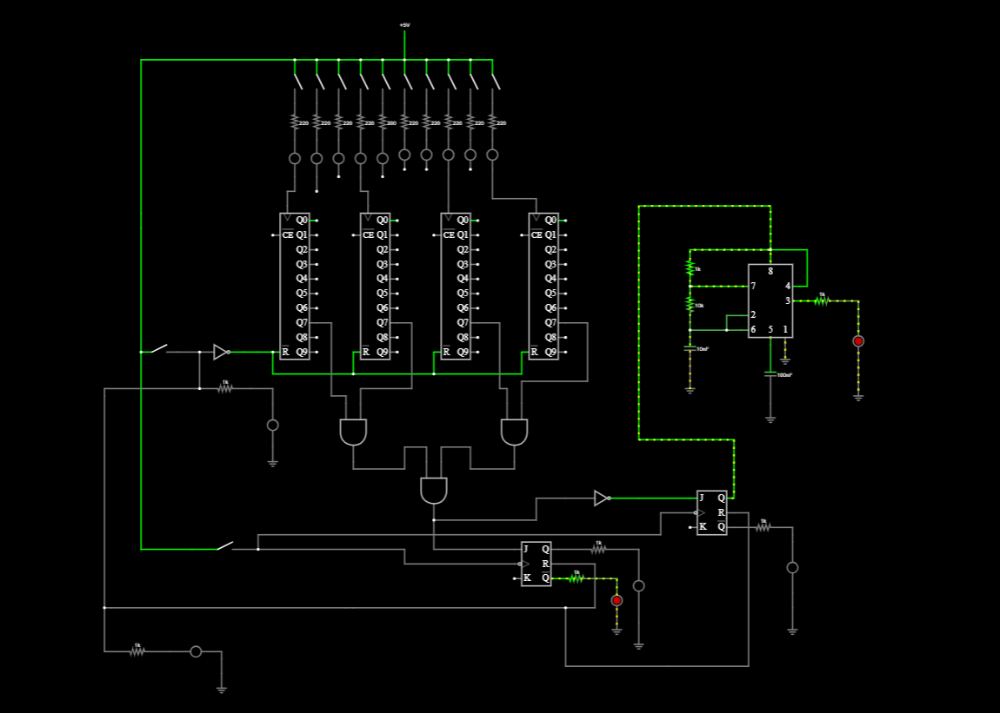

# IC-Based-Digital-Door-Lock
Digital door lock circuit using logic ICs, flip-flops, and a 555 timer
# IC-Based Digital Door Lock Circuit

## Overview

This project involves the design of an IC-based digital door lock circuit using digital logic components and a 555 timer. It demonstrates the application of sequential logic, timing circuits, and logic gates in an electronic access-control system.

## Objectives

* Design a digital logic-based door lock circuit.
* Understand the operation of counter ICs and flip-flops.
* Implement control logic using digital logic gates.
* Explore timing control using the 555 timer.

## Circuit Schematic

## Components and Concepts

* Decade Counter ICs
* AND, NOT gate
* 555 timer IC
* Logic gates
* JK flip-flops
* Resistors and capacitors
* Digital sequential logic

## Working Principle

The circuit combines digital logic and sequential control to process input conditions and manage the locking sequence. The counter and flip-flop stages maintain the circuit's logic states, while the timer provides timing control.

*The exact locking sequence and operating behavior should be confirmed through simulation or hardware testing.*

## Tools Used

* Electronic circuit design and simulation software

## Project Status

Circuit schematic designed. Simulation and hardware validation status will be updated as testing progresses.

## Future Improvements

* Simulate and verify the complete circuit.
* Add a practical electronic lock actuator.
* Test circuit reliability under different input conditions.
* Document the operating sequence and timing behavior.
